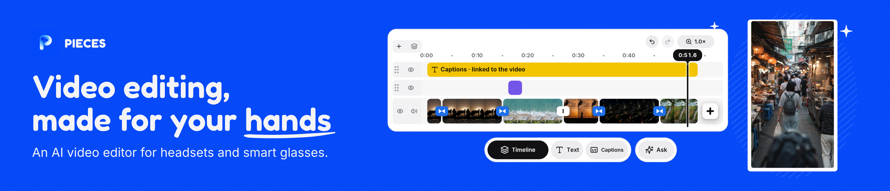
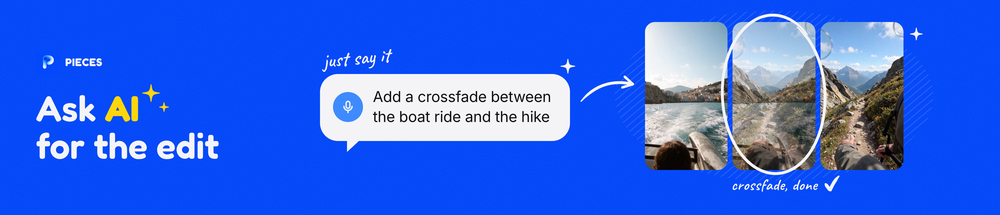
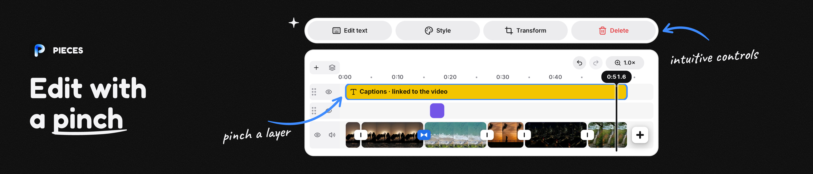
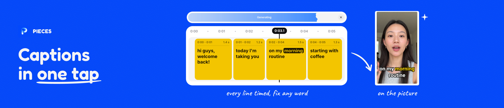
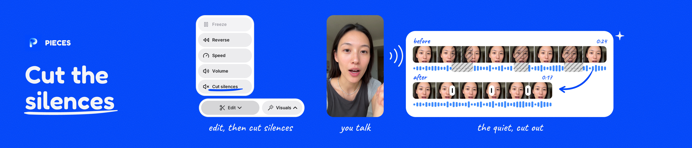
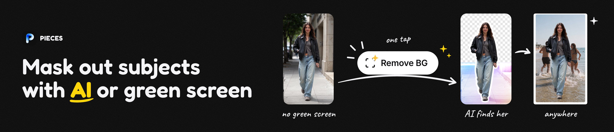
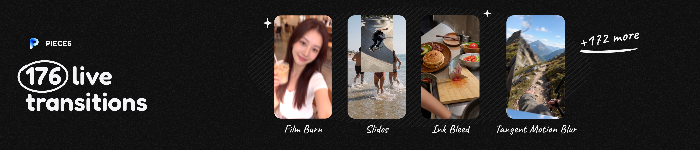
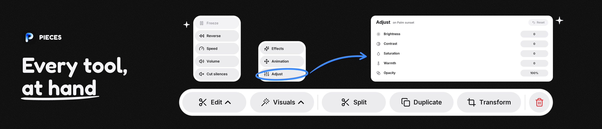

# Pieces: Devpost images

The banners on the Devpost page of Pieces, a video editor built for VR headsets and smart glasses. The page loads them from this repo's raw links, so keep the file names and paths as they are.

